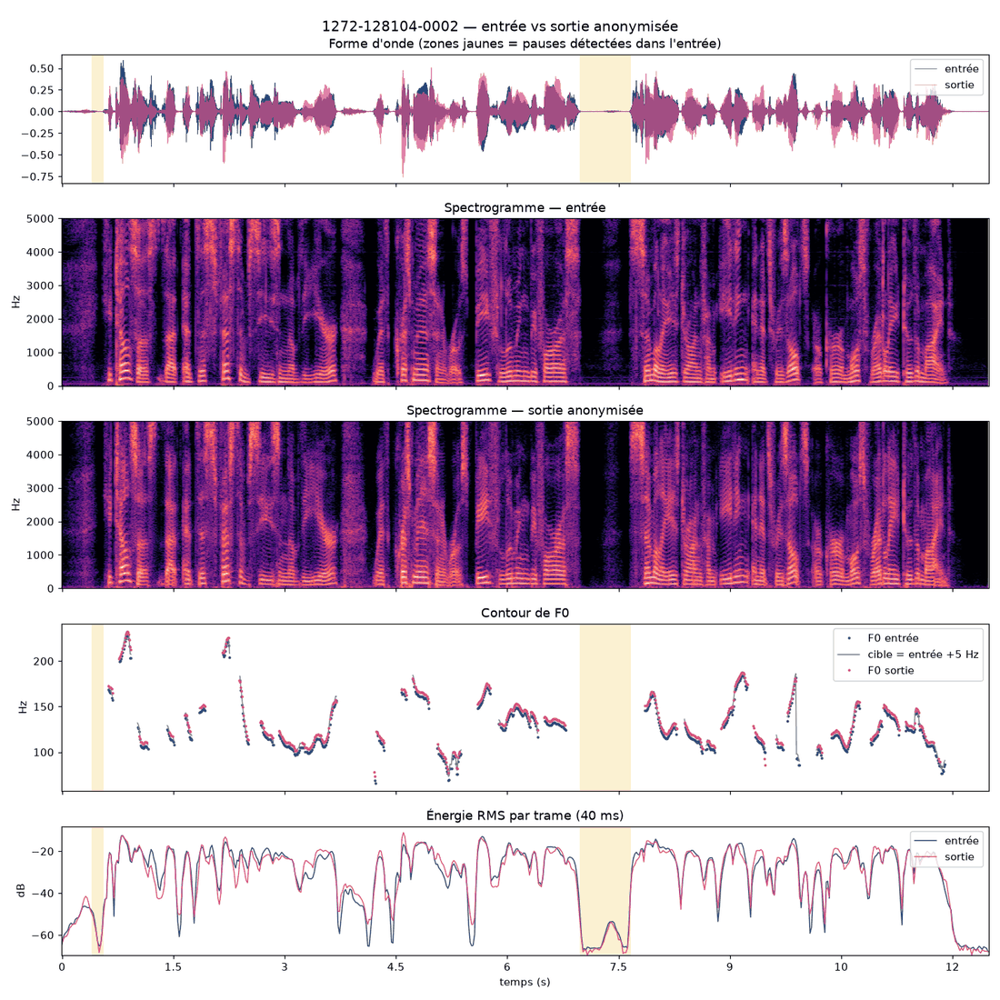
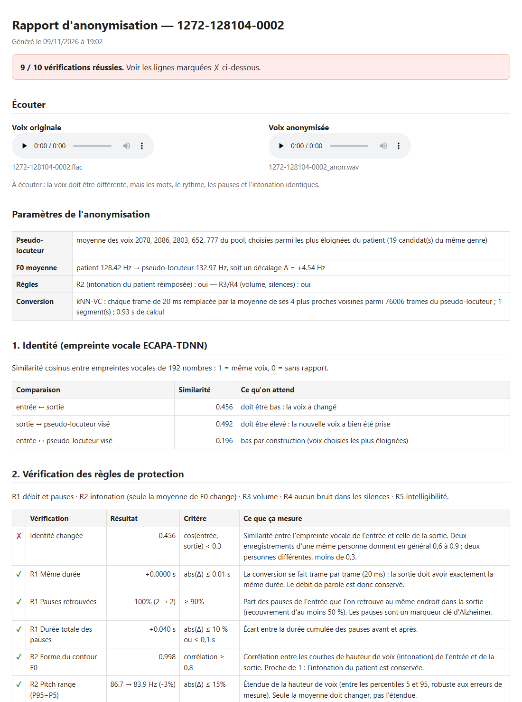

# voice_anon — anonymisation de la voix préservant les marqueurs d'Alzheimer

Projet tuteuré : *Module IA de conversion de voix en vue d'anonymiser le locuteur*
(Adam Derbel, Zaineb Chouari — encadré par Mme Sofia Ben Jebara).

L'application change **l'identité** d'une voix (le timbre) tout en conservant **ce qui porte la
pathologie** : durée, pauses, intonation, volume, contenu.

<p align="center">
  
  
</p>

*Exemple de rapport sur une voix publique LibriSpeech (dev-clean, locuteur 1272, extrait
`1272-128104-0002`) — aucune voix de patient. À gauche, la figure du rapport : les pauses (en jaune),
le contour de F0 et l'énergie de la sortie suivent ceux de l'entrée, alors que le timbre change. À
droite, le haut du rapport HTML : verdict, paramètres, empreinte vocale et vérification des règles.*

## Les deux commandes

```powershell
# 1. Anonymiser (un fichier, ou un dossier contenant UN seul patient)
python anonymiser.py "..\dataset\ad\001-0 (1).wav"
python anonymiser.py ..\dataset\patient_001 --whisper base

# 2. Comparer : originale, anonymisée, puis un ou plusieurs AUTRES extraits de la même personne
python comparer.py "..\dataset\ad\001-0 (1).wav" "results\001-0 (1)\audio\001-0 (1)_anon.wav" "..\dataset\ad\001-2 (1).wav"
```

Chaque commande produit un **rapport HTML** à ouvrir dans le navigateur : verdict, les deux audios
à écouter, l'identité, la vérification des règles R1–R5, les courbes et les mesures Praat, chaque
métrique étant expliquée.

### Sorties de `anonymiser.py` (dans `results\<nom>\`)

| Fichier | Contenu |
|---|---|
| `audio\<fichier>_anon.wav` | la voix anonymisée (16 kHz, même durée que l'original) |
| `audio\<fichier>_anon.json` | ce qui a été fait : pseudo-locuteur, décalage de F0, réglages |
| `rapports\<fichier>_rapport.html` | le rapport explicatif (figure intégrée) |
| `rapports\<fichier>_rapport.json` | toutes les mesures, pour des analyses par script |
| `rapports\<fichier>_courbes.png` | la figure seule |
| `index.html` | la synthèse de tous les fichiers traités |

### Options utiles

| Option | Défaut | Rôle |
|---|---|---|
| `--whisper base` | désactivé | mesure l'intelligibilité (R5) ; `pip install openai-whisper` |
| `--out-dir` | `results\<nom>` | dossier de sortie |
| `--f0-mode knn` | `transfer` | désactive R2 (pour l'étude d'ablation) |
| `--no-rules` | — | désactive R3 et R4 (pour l'étude d'ablation) |
| `--gender any` | `same` | autorise un pseudo-locuteur de l'autre genre (déconseillé : grand décalage de F0) |
| `--n-farthest`, `--n-select` | 10, 5 | on garde les 10 voix les plus éloignées puis on en tire 5 |
| `--topk` | 4 | nombre de voisins moyennés par kNN-VC pour chaque trame |
| `--patient-id` | nom du fichier/dossier | graine : un même patient reçoit toujours le même pseudo-locuteur |

Pour `comparer.py` : `--whisper` (comme ci-dessus) et `--out-dir` (défaut : `results\comparaisons`).

## Installation (une fois)

```powershell
python -m venv .venv
.venv\Scripts\activate
# PyTorch avec GPU : prendre la commande de https://pytorch.org/get-started/locally/ (torch + torchaudio)
pip install -r requirements.txt
python setup_models.py all          # ECAPA (66 Mo), kNN-VC (1,3 Go)
```

Le pool de voix **LibriSpeech dev-clean** (≈ 340 Mo) n'est pas téléchargé par `setup_models.py` :
le récupérer à la main sur https://www.openslr.org/12 (`dev-clean.tar.gz`) et l'extraire dans
`..\librispeech\` (voir l'organisation ci-dessous). Ce dossier est obligatoire, même si
`cache\pool\` existe déjà.

Au premier lancement de `anonymiser.py`, le pool de voix est pré-calculé (quelques minutes sur GPU),
puis relu depuis `cache\pool\`.

Organisation attendue :

```
tuteure\
├── dataset\                              voix des patients
├── librispeech\LibriSpeech\dev-clean\    pool de voix (un sous-dossier par locuteur)
└── voice_anon\                           ce projet
```

N'importe quel autre corpus peut servir de pool, à condition d'avoir un sous-dossier par locuteur
(`--pool-dir ... --cache cache\pool_autre`).

## Architecture

| Fichier | Étape | Rôle |
|---|---|---|
| `anon/audio.py` | 1 | chargement 16 kHz, détection de la parole et des pauses |
| `anon/prosody.py` | 2 | F0, énergie, pauses, jitter, shimmer, HNR (Praat) |
| `anon/speaker.py` | 3 | empreinte vocale ECAPA-TDNN (192 dimensions) |
| `anon/knnvc.py` | 4 | chargement de WavLM (contenu) et HiFi-GAN (vocodeur) |
| `anon/pseudo_speaker.py` | 4 | pool de voix, choix du pseudo-locuteur (les plus éloignées) |
| `anon/convert.py` | 5 | conversion kNN-VC + règles R1–R4 |
| `anon/compare.py` | 6 | mesures entrée / sortie et vérifications |
| `anon/report.py` | 7 | rapport HTML explicatif |
| `anonymiser.py`, `comparer.py` | 7 | les deux commandes de l'application |
| `setup_models.py` | — | téléchargements (avec reprise) |
| `parquet_vers_wav.py` | — | convertit un dataset `.parquet` (HuggingFace) en `.wav` 16 kHz, un sous-dossier par locuteur ; nécessite `pyarrow` |

Règles de protection : **R1** même durée et mêmes pauses (conversion trame à trame) ·
**R2** intonation du patient réimposée, seule la moyenne de F0 change · **R3** même volume ·
**R4** aucun bruit dans les silences · **R5** mêmes mots (WER Whisper).

## Limites connues

- Les seuils des vérifications sont indicatifs (en haut de `anon/compare.py`).
- Si l'interviewer parle dans l'enregistrement, sa voix est convertie avec celle du patient et
  perturbe l'empreinte et la F0 moyenne.
- Jitter, shimmer et HNR sont modifiés par le vocodeur : ils sont rapportés, pas garantis.
- La mesure d'anonymat standard (EER d'un vérificateur sur de nombreuses paires) et l'évaluation
  pathologique ne font pas partie de cette version.

## Crédits

kNN-VC (Baas et al., 2023, licence MIT) · ECAPA-TDNN (Desplanques et al., 2020 ; poids
TaoRuijie/ECAPA-TDNN) · sélection du pseudo-locuteur : baseline du VoicePrivacy Challenge
(Fang et al., 2019) · LibriSpeech (CC-BY 4.0) · Praat via parselmouth.
